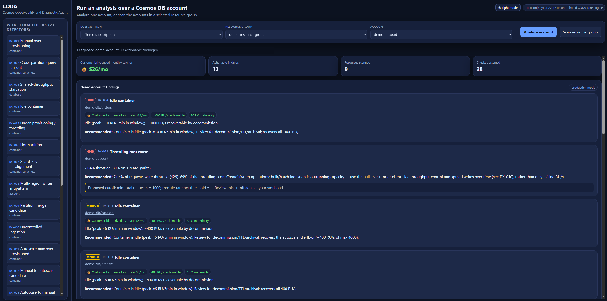

# CODA

**CODA** (Cosmos Observability and Diagnostic Agent) is a local, read-only diagnostic tool for
**Azure Cosmos DB for NoSQL**. Select an account or resource group to find throughput waste,
throttling, partition hot spots, expensive queries, and configuration risks.

CODA has a browser UI and an optional MCP server. Its 23 detectors share the same Python engine;
the web app does not require an AI model, an API key, or a hosted CODA service.

**Preview release.** Package checks do not establish complete live validation of every detector.
Fresh all-detector acceptance and signed-in verification of the Portal links are deferred for this
preview. Review the detector limitations and incomplete evaluations; do not treat absence of a
finding as proof that a resource is healthy.



*Example account analysis. Subscription and resource identifiers have been replaced with demo names;
findings and estimated savings depend on your workload and available evidence.*

| Guide | What you will find |
|---|---|
| [Detector reference](docs/detectors.md) | Every detector, its data sources, analysis window, and recommended next step |
| [Permissions and sign-in](docs/permissions.md) | Microsoft Entra authentication, RBAC roles and scopes, optional cost access |
| [Log Analytics setup and readiness](docs/detections/log-analytics-readiness.md) | Required categories, resource-specific tables, collection time, and troubleshooting |
| [Architecture and data flow](docs/architecture.md) | Components, Azure services, outbound connections, and data handling |

## Safety and access boundary

CODA is diagnose-only and read-only. It reads resource configuration, Azure Monitor metrics, and
supported Log Analytics records. It does not modify Azure resources or read application documents.

Authentication uses Microsoft Entra ID only. CODA does not accept or require account keys,
connection strings, or other long-lived credentials. Sign in with an identity that has only the
read permissions needed for the resources you choose to diagnose.

## Requirements

- Windows, macOS, or Linux
- Python 3.12 or newer
- [Azure CLI](https://learn.microsoft.com/en-us/cli/azure/install-azure-cli) for the simplest local sign-in
- Microsoft Entra access to the Azure resources you want to diagnose; see [RBAC](docs/permissions.md)
- Outbound HTTPS access to Azure authentication and monitoring APIs

Log Analytics is optional: four detectors require its resource-specific logs. Other checks use
configuration and metrics, but some still need historical metrics or a sufficiently old resource.
**Enabling logs does not make every detector fire.** See [readiness](docs/detections/log-analytics-readiness.md).

## Install

Choose a release wheel for normal use, or clone/download the repository to run from source.
**PyPI publication is not available**: do not use an unqualified `pip install coda`.
If the [Releases page](https://github.com/AzureCosmosDB/coda/releases) has no release yet, use the
source option below.

### Option 1: Download a release

Create an isolated environment:

```console
python -m venv .venv
```

Activate it with `.\.venv\Scripts\Activate.ps1` in Windows PowerShell, or
`source .venv/bin/activate` on macOS/Linux. If PowerShell blocks activation, use
`.\.venv\Scripts\python.exe` and `.\.venv\Scripts\coda.exe` directly instead.

Download `coda-<version>-py3-none-any.whl` and `SHA256SUMS.txt` from the same
[GitHub Release](https://github.com/AzureCosmosDB/coda/releases). Replace `<version>` with the
selected version everywhere below. In the download directory, verify the wheel:

```console
python -c "import hashlib, pathlib; wheel = pathlib.Path('coda-<version>-py3-none-any.whl'); lines = pathlib.Path('SHA256SUMS.txt').read_text(encoding='utf-8').splitlines(); expected = next(line.split()[0] for line in lines if line.split()[-1].lstrip('*') == wheel.name); actual = hashlib.sha256(wheel.read_bytes()).hexdigest(); assert actual == expected, f'SHA-256 mismatch: {actual} != {expected}'; print(f'SHA-256 verified: {actual}')"
```

Install the verified local wheel:

```console
python -m pip install "./coda-<version>-py3-none-any.whl"
```

Alternatively, install directly from the versioned release URL:

```console
pip install "https://github.com/AzureCosmosDB/coda/releases/download/v<version>/coda-<version>-py3-none-any.whl"
```

To use the MCP server, install the optional `mcp` extra from that same wheel asset:

```console
pip install "coda[mcp] @ https://github.com/AzureCosmosDB/coda/releases/download/v<version>/coda-<version>-py3-none-any.whl"
```

For a downloaded wheel with MCP support, use
`python -m pip install "./coda-<version>-py3-none-any.whl[mcp]"`.
The base installation already includes the web UI; MCP is the only optional extra.

### Option 2: Clone or download the source

Install [uv](https://docs.astral.sh/uv/getting-started/installation/) at the version required by
`pyproject.toml` (currently `0.12.3`). Then:

```console
git clone https://github.com/AzureCosmosDB/coda.git
cd coda
uv sync --locked
uv run --no-sync coda web
```

Without Git, choose **Code > Download ZIP** on the repository page, extract it, open a terminal in
the extracted directory containing `pyproject.toml`, and run the last two commands.
For a specific released source version, select its tag rather than the moving `main` branch.

To add MCP support to a source checkout:

```console
uv sync --locked --extra mcp
uv run --no-sync coda mcp
```

Stop the stdio MCP process with Ctrl+C when testing it from a terminal; normally an MCP client
starts and manages that process.

## Run CODA

### Sign in to Azure

Use your own tenant and subscription, not a service account or account key:

```console
az login --tenant "<tenant-id>"
az account set --subscription "<subscription-id>"
```

CODA uses `DefaultAzureCredential`. Its **Sign in** button enables use of your existing local Azure
credential; it is not a separate CODA account or guaranteed browser login prompt. If discovery
fails, complete `az login` first. See [credential selection and troubleshooting](docs/permissions.md).

### Use the browser UI

Start the installed application (or use `uv run --no-sync coda web` in a source checkout):

```console
coda web
```

Open **http://127.0.0.1:8000/**. If that port is occupied, use `coda web --port 8080` and open
http://127.0.0.1:8080/ instead. Keep the terminal open; Ctrl+C stops the app.

1. Select **Sign in**, then select your subscription. Enable **All subscriptions** if the default
   Cosmos-named subscription filter hides yours.
2. Select a resource group. Choose **Scan resource group** for its supported NoSQL accounts, or
   select an account and diagnose only that account.
3. Review findings and recommendations, then expand **Detector/resource evaluations we couldn't
   complete**. Missing permissions, missing logs, and insufficient history are not a clean result.

Web scans use production analysis windows. A large resource group can take time; start with a
single account if you are checking setup. Discovery lists account metadata within the selected
subscription, but the web scan itself is restricted to the selected resource group.

CODA recommends changes; you decide whether and how to apply them. Resource links open Azure
Portal. Agent Kit identifiers and detailed metadata remain in structured reports rather than
cluttering the web results.

**Keep CODA bound to loopback.** Do not expose it with `--host 0.0.0.0`, port forwarding, or a public
reverse proxy. This is a single-user local application, not an authenticated multi-user service.

### Use an MCP client

With the `mcp` extra installed, configure your client to start:

```console
coda mcp
```

For example, a VS Code `.vscode/mcp.json` entry:

```json
{
  "servers": {
    "coda": {
      "type": "stdio",
      "command": "coda",
      "args": ["mcp"]
    }
  }
}
```

The client must be able to find the installed executable and Azure credentials. If it does not
inherit your activated environment, set `command` to the full path of that environment's `coda`
executable. For source installs you can instead configure `uv` with the checkout's working directory.

Ask the client to list detectors or diagnose a specific account. MCP also exposes subscription
scan tools; explicitly request resource-group/account filters for large subscriptions. The
`coda` terminal launcher has `web` and `mcp` commands, not a `coda diagnose` command.

MCP reports are returned to your chosen client. Its model/provider may process those reports under
its own privacy settings; review that policy before sharing customer telemetry with an AI service.

## Troubleshooting

| Symptom | Check |
|---|---|
| Authentication failed or no subscriptions | Run `az login`, confirm the tenant and roles, and check **All subscriptions** |
| Missing resource group/account | Verify Azure access; discovery currently selects NoSQL accounts |
| Log Analytics checks cannot complete | Enable both required categories in **Resource specific** mode; see the [setup guide](docs/detections/log-analytics-readiness.md) |
| Too new, too few samples, or no finding | Check the detector's window, resource applicability, traffic volume, and thresholds; absence of a finding is not proof of full coverage |
| Cost amounts unavailable | Cost access and usable billing data are optional; capacity/recommendations can still be useful |
| `coda` is not found | Activate the installation environment or use the full executable path |
| `coda mcp` says the extra is missing | Reinstall the selected wheel with `[mcp]`, or run `uv sync --locked --extra mcp` |

## Update

For a wheel install, download and verify the new release, then install that wheel with
`python -m pip install --upgrade "./coda-<version>-py3-none-any.whl"` (include `[mcp]` if needed).
For a clean source checkout, use `git pull --ff-only` and `uv sync --locked` before restarting.
Do not discard local changes to update. Packaged web/MCP processes do not self-update.

## Feedback and support

Use [public GitHub Issues](https://github.com/AzureCosmosDB/coda/issues) for product problems, feature
requests, and diagnostic feedback. When sharing diagnostic feedback, attach only the
`*-redacted.json` artifact after reviewing it. Never attach a full report, credentials, resource
identifiers, or customer data.

External code contributions are not accepted. See [CONTRIBUTING.md](CONTRIBUTING.md) and
[SUPPORT.md](SUPPORT.md) for the public feedback and support policy.

## Security

Do not report suspected vulnerabilities in a public Issue. Use
[GitHub Private Vulnerability Reporting](https://github.com/AzureCosmosDB/coda/security/advisories/new)
as described in [SECURITY.md](SECURITY.md).
